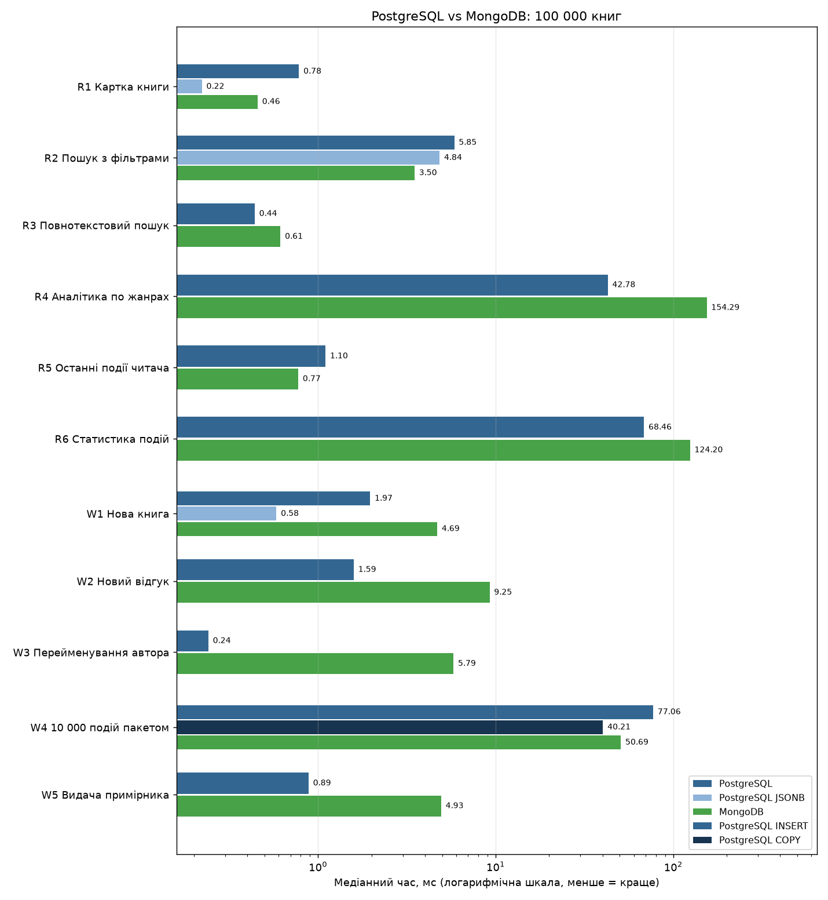

# Звіт з лабораторної роботи №2

**Тема:** NoSQL бази даних. Порівняння швидкодії реляційної та документної моделей

**Предметна область:** система управління бібліотекою з додатковими послугами (продовження лабораторної роботи №1)

**Виконала:** Анна Кучерова

---

## Мета роботи

Ознайомитися з видами NoSQL баз даних, визначити, яку частину даних предметної області доцільно винести в NoSQL, реалізувати її в документній базі MongoDB і в PostgreSQL, порівняти швидкодію обох реалізацій, а також освоїти базові запити NoSQL-бази іншого типу (Redis).

## Завдання

1. Ознайомитись з видами NoSQL баз.
2. Враховуючи предметну область, визначити, чи буде ефективніше винести частину даних в іншу базу, і навести аргументи.
3. Винести частину даних в обрану NoSQL базу або розширити предметну область вимогами, які роблять використання NoSQL доцільним. Реалізувати.
4. Реалізувати те саме в SQL базі.
5. Протестувати швидкодію: порівняти відповідні SQL та NoSQL фрагменти баз. NoSQL має відображатися в кілька SQL таблиць. Перевірка швидкодії має бути логічно обґрунтована.
6. Обрати NoSQL базу іншого типу, розібратися в ній і реалізувати базові запити.

## Використані технології

- **PostgreSQL 18** — реляційна база (з лабораторної роботи №1);
- **MongoDB 8.0** — документна NoSQL база (завдання 2–5);
- **Redis 8** — key-value NoSQL база (завдання 6);
- **Python 3** (`pymongo`, `psycopg`, `redis`, `matplotlib`) — генерація даних, тестування, демонстрація;
- MacBook Air (Apple Silicon), macOS.

---

## Хід роботи

### 1. Види NoSQL баз

NoSQL (Not only SQL) — це бази, які не використовують реляційну модель «таблиці + зв'язки + JOIN». Зазвичай вони жертвують частиною можливостей SQL (складні JOIN, сувора схема, іноді ACID-транзакції між записами), щоб отримати гнучку схему, просте горизонтальне масштабування або дуже високу швидкість для конкретного типу запитів.

| Тип | Як зберігає дані | Приклади | Для чого підходить | Слабкі місця |
|---|---|---|---|---|
| **Key-Value** | Пари «ключ → значення», значення для бази — «чорна скринька» або проста структура (рядок, список, множина) | Redis, Memcached, Amazon DynamoDB, etcd | Кеш, сесії, лічильники, черги, рейтинги, обмеження частоти запитів | Пошук тільки за ключем, немає запитів за вмістом значення |
| **Документні** | Документи JSON/BSON зі вкладеними об'єктами та масивами, у кожного документа може бути своя структура | MongoDB, CouchDB, Firestore | Каталоги товарів, профілі, контент, дані зі змінною структурою, агрегати, які читаються цілком | Дублювання даних, складні зв'язки між документами, аналітика по всій колекції |
| **Колонкові (wide-column)** | Рядки з динамічним набором колонок, дані розподілені за ключем розділу | Apache Cassandra, ScyllaDB, HBase | Величезні потоки запису: логи, метрики, IoT, історія подій | Запити тільки за заздалегідь спроєктованим ключем, немає JOIN і довільних фільтрів |
| **Графові** | Вузли та ребра з властивостями | Neo4j, ArangoDB, Amazon Neptune | Соціальні зв'язки, рекомендації, маршрути, пошук шахрайства | Слабкі в масових табличних звітах |
| **Часових рядів** | Значення, прив'язані до часу, з автоматичним стисненням і агрегацією | InfluxDB, TimescaleDB, Prometheus | Метрики, моніторинг, телеметрія | Вузька спеціалізація |
| **Пошукові** | Інвертовані індекси для тексту | Elasticsearch, OpenSearch | Повнотекстовий пошук, фасетні фільтри, логи | Не є основним сховищем, слабкі транзакції |

Важливо: NoSQL не «швидший за SQL взагалі». Кожен тип швидший для свого шаблону доступу і повільніший для інших. Саме це я і перевіряю в пункті 5.

---

### 2. Чи варто виносити частину даних у NoSQL

У базі з лабораторної 1 є 25 таблиць. Їх можна поділити на дві групи з дуже різним характером роботи.

**Залишається в PostgreSQL** — облік і гроші: читачі, абонементи, видачі (`loans`), штрафи, платежі, бронювання приміщень, реєстрації на заходи. Тут критичні:

- ACID-транзакції між кількома таблицями (видача книги = позика + зміна статусу примірника + перевірка боргу);
- цілісність (FK, CHECK, EXCLUDE: одне приміщення не можна забронювати двічі);
- звіти з JOIN і GROUP BY для бухгалтерії.

Документна модель тут нічого не дає, а втратити гарантії цілісності для грошей і боргів неприпустимо.

**Доцільно винести в MongoDB** — публічний каталог і журнал активності читачів.

1. **Каталог книг читається в сотні разів частіше, ніж змінюється.** Щоб показати сторінку книги, в SQL треба зібрати дані з 8–12 таблиць (книга, видавництво, автори, жанри, теги, примірники у філіях, відгуки). У документній базі це **один документ**, який читається одним запитом за `_id`.
2. **Нова вимога: різні формати видань.** Бібліотека додає електронні книги та аудіокниги. У них різні атрибути: формат файлу, розмір, DRM — для електронних; диктор і тривалість — для аудіо; кількість сторінок і фізичні примірники — для паперових. У SQL це або окрема таблиця для кожного типу, або EAV, або багато NULL-колонок. У документі це просто поле `details` з різною структурою.
3. **Теги та довільні характеристики** (`бестселер`, `екранізація`, `для_студентів`) додаються без міграцій схеми.
4. **Журнал активності читачів** (пошукові запити, перегляди, бронювання, завантаження): великий потік записів, різні поля для різних типів подій, без транзакційних зв'язків. Це класичний випадок для NoSQL.

**Аргументи проти (і як я їх враховую):**

- Дублювання. Ім'я автора зберігається в кожному документі його книги, тому при перейменуванні автора треба оновити багато документів. Перевірено в тесті W3.
- Аналітика по всій колекції (групування за жанрами) у документній базі зазвичай повільніша. Перевірено в R4 і R6.
- Узгодженість. Джерелом правди для примірників і видач лишається PostgreSQL, а каталог у MongoDB є моделлю для читання, яку синхронізує застосунок. Скрипт `migrate_from_lab1.py` показує саме перенесення каталогу з бази лабораторної 1.

**Висновок:** транзакційне ядро лишається в PostgreSQL. Каталог із форматами видань і журнал активності виносяться в MongoDB, бо там переважає читання цілих агрегатів, гнучка структура та потоковий запис. Кеш, сесії й рейтинги краще тримати в Redis (пункт 6).

---

### 3. Реалізація в MongoDB

База `library_lab2`, три колекції.

#### Колекція `books` — картка видання

```json
{
  "_id": 1,
  "isbn": "9780000000001",
  "title": "Тихий сад історія",
  "language": "uk",
  "format": "ebook",
  "publish_year": 2014,
  "pages": 312,
  "description": "...",
  "publisher": { "id": 17, "name": "Видавництво Мельник-17", "city": "Львів" },
  "authors": [ { "id": 5, "name": "Ольга Коваленко", "country": "Україна" } ],
  "genres": [ { "id": 1, "name": "Роман" }, { "id": 7, "name": "Детектив" } ],
  "tags": [ "бестселер", "екранізація" ],
  "details": { "file_format": "epub", "size_mb": 3.2, "drm": false },
  "copies": [
    { "copy_id": 10, "inventory_code": "INV-1-0000010", "branch": { "id": 1, "name": "Філія №1 (Київ)" }, "status": "available" }
  ],
  "rating": { "sum": 41, "count": 10, "avg": 4.1 },
  "recent_reviews": [ { "review_id": 77, "member": { "id": 3, "name": "Анна Петренко" }, "rating": 5, "comment": "...", "created_at": "2026-05-01T10:00:00Z" } ],
  "created_at": "2024-01-15T00:00:00Z"
}
```

Використані патерни моделювання MongoDB:

- **Embedding** (вкладення) — автори, жанри, примірники, видавництво зберігаються всередині документа, бо читаються разом із книгою;
- **Extended Reference** — у вкладених об'єктах лише `id` і поля, потрібні для відображення (`name`), а не весь автор;
- **Subset Pattern** — у книзі лише 5 останніх відгуків і готова статистика рейтингу, а всі відгуки лежать в окремій колекції `reviews`, щоб документ не ріс безмежно;
- **Polymorphic Pattern** — поле `details` має різну структуру для `ebook` і `audiobook`, а в паперових книг його немає зовсім;
- **Computed Pattern** — `rating.sum / count / avg` перераховуються під час запису відгуку, а не при кожному читанні.

#### Колекції `reviews` і `events`

```json
{ "_id": 12, "book_id": 1, "member": { "id": 3, "name": "Анна Петренко" }, "rating": 5, "comment": "...", "created_at": "..." }

{ "_id": 1, "member_id": 42, "type": "search",  "ts": "...", "device": "ios", "query": "детектив", "results_count": 87 }
{ "_id": 2, "member_id": 42, "type": "view",    "ts": "...", "device": "web", "book_id": 15, "duration_sec": 140 }
{ "_id": 3, "member_id": 42, "type": "reserve", "ts": "...", "device": "web", "book_id": 15, "branch_id": 1 }
```

Набір полів залежить від типу події.

#### Валідація та індекси

Попри гнучку схему, обов'язкові поля та типи перевіряються через `$jsonSchema`-валідатор колекції (`mongo_schema.py`): формат лише `print` / `ebook` / `audiobook`, хоча б один автор, рейтинг відгуку 1–5, не більше 5 відгуків у `recent_reviews`.

| Колекція | Індекс | Для якого запиту |
|---|---|---|
| books | `isbn` (unique) | унікальність ISBN |
| books | `genres.id + language + publish_year` (multikey, складений) | пошук у каталозі з фільтрами |
| books | `rating.avg` | сортування за рейтингом |
| books | `authors.id`, `tags`, `copies.copy_id`, `copies.branch.id + copies.status` | пошук за автором, тегом, примірником, наявністю у філії |
| books | текстовий `title + description` | повнотекстовий пошук |
| reviews | `book_id + created_at` | відгуки книги |
| events | `member_id + ts`, `type + ts`, `ts` | історія читача, статистика за період |

Приклад запиту пошуку в каталозі (сценарій R2): умова на вкладений масив примірників перевіряється всередині документа через `$elemMatch`:

```python
db.books.find(
    {"genres.id": genre_id, "language": "uk",
     "publish_year": {"$gte": y1, "$lte": y2},
     "copies": {"$elemMatch": {"branch.id": branch_id, "status": "available"}}},
    {"title": 1, "authors.name": 1, "rating.avg": 1},
).sort("rating.avg", -1).limit(20)
```

Додавання відгуку (сценарій W2): рейтинг книги і список останніх відгуків перераховуються одним оновленням документа:

```python
db.books.update_one({"_id": book_id}, [
    {"$set": {"rating.sum": {"$add": ["$rating.sum", rating]},
              "rating.count": {"$add": ["$rating.count", 1]}}},
    {"$set": {"rating.avg": {"$round": [{"$divide": ["$rating.sum", "$rating.count"]}, 3]},
              "recent_reviews": {"$slice": [{"$concatArrays": [[review], "$recent_reviews"]}, 5]}}},
])
```

Інші приклади запитів для `mongosh` / MongoDB Compass: [`mongo/queries.js`](mongo/queries.js).

---

### 4. Те саме в PostgreSQL

Щоб порівняння було чесним, той самий фрагмент предметної області реалізовано в нормалізованому вигляді в окремій схемі `lab2` (файли [`sql/schema.sql`](sql/schema.sql), [`sql/indexes.sql`](sql/indexes.sql)).

**Один документ `books` у MongoDB відповідає 12 таблицям PostgreSQL:**

| Частина документа | Таблиці SQL |
|---|---|
| сама книга, `rating` | `books` (`rating_sum`, `rating_count`) |
| `publisher` | `publishers` |
| `authors[]` | `book_authors` + `authors` |
| `genres[]` | `book_genres` + `genres` |
| `tags[]` | `book_tags` |
| `details` (ebook / audiobook) | `ebook_details`, `audiobook_details` (table-per-type) |
| `copies[]` | `book_copies` + `branches` |
| `recent_reviews[]` | `reviews` + `members` |

Колекція `events` відповідає таблиці `reader_events`, де поля, специфічні для типу події, є nullable-колонками.

Додатково є третій варіант — **PostgreSQL JSONB** (таблиця `book_documents`, GIN-індекс `jsonb_path_ops`). У ній лежать ті самі документи, що й у MongoDB. Це відповідь на питання «а чи не простіше тримати документ прямо в PostgreSQL?».

Той самий пошук у каталозі в SQL потребує з'єднання з таблицею жанрів і підзапиту до примірників:

```sql
SELECT b.book_id, b.title, b.rating_sum::numeric / nullif(b.rating_count, 0) AS avg_rating
  FROM books b
  JOIN book_genres bg ON bg.book_id = b.book_id AND bg.genre_id = %(genre)s
 WHERE b.language = 'uk'
   AND b.publish_year BETWEEN %(y1)s AND %(y2)s
   AND EXISTS (SELECT 1 FROM book_copies c
                WHERE c.book_id = b.book_id AND c.branch_id = %(branch)s AND c.status = 'available')
 ORDER BY avg_rating DESC NULLS LAST
 LIMIT 20;
```

Індекси в SQL відповідають індексам MongoDB: складені, повнотекстовий GIN по `to_tsvector`, функціональний індекс за рейтингом, індекси на всіх FK.

---

### 5. Тестування швидкодії

#### 5.1 Дані

Генератор `generate.py` створює **однакові** дані в обох базах. Він детермінований (seed = 42), тож повторний запуск дає ті самі книги, авторів і відгуки. Розподіли наближені до реальних:

- популярність авторів і книг за законом Ципфа: кілька авторів мають сотні книг, більшість — 1–2. Це важливо для тесту W3;
- 70 % паперових, 20 % електронних, 10 % аудіокниг; мови uk / en / pl;
- 1–6 примірників у паперових книг, статуси available / on_loan / in_repair;
- кількість відгуків має експоненційний розподіл (у середньому 4–5 на книгу, максимум 40).

Тести проведено на двох обсягах, щоб побачити, як змінюється час із ростом даних:

| Обсяг | Книги | Автори | Читачі | Примірники | Відгуки | Події |
|---|---:|---:|---:|---:|---:|---:|
| малий | 10 000 | 2 000 | 5 000 | 24 527 | 44 778 | 100 000 |
| основний | **100 000** | 20 000 | 50 000 | 245 555 | 451 221 | **1 000 000** |

Чому саме такий обсяг: при 100 000 книг таблиці й індекси займають сотні мегабайт (див. 5.5). Це вже реальний масштаб міської бібліотечної мережі, і різниця між підходами з'являється там, де при кількох тисячах рядків її не видно (тест R2). Водночас генерація займає близько 1,5 хвилини, тож експеримент легко повторити. Генератор приймає параметр `--books`, тому тест можна запустити й на більшому обсязі.

#### 5.2 Методика

- Обидві СУБД працюють на одній машині, з'єднання встановлюється один раз і використовується повторно.
- **Однакові параметри:** для кожної ітерації генерується параметр (id книги, жанр, автор…), і з ним виконуються всі варіанти.
- **Порядок СУБД у кожній ітерації випадковий.** Інакше одна база систематично отримувала б «теплий» кеш після іншої або страждала б від фонових процесів.
- **Прогрів:** перші 30 ітерацій не враховуються. Тестується робота з «гарячими» даними, як на робочому сервері.
- Основні сценарії мають **300 вимірювань**. Важкі аналітичні запити мають 15, пакетний запис — 10 по 10 000 подій.
- Метрики: **медіана** (не чутлива до поодиноких сплесків), **p95** (стабільність), мінімум, операцій за секунду.
- Час міряється на стороні клієнта (`time.perf_counter_ns`), включно з передачею даних і розбором результату драйвером. Саме цей час бачить застосунок. Результат запиту обов'язково зчитується повністю.
- **Довговічність запису однакова.** PostgreSQL працює з `synchronous_commit = on`, MongoDB — з `writeConcern {w: 1, j: true}`. Обидві підтверджують запис лише після запису журналу на диск. Без цього MongoDB у тестах запису мала б нечесну перевагу.
- Кожен запит перевірено через `EXPLAIN` (`results/plans_100k.txt`): обидві бази використовують індекси, а не повний перебір.
- Перед кожним прогоном `benchmark.py` видаляє дані, додані попереднім прогоном, і виконує `VACUUM ANALYZE`.

#### 5.3 Сценарії і навіщо кожен

| Код | Що робимо | Що перевіряємо |
|---|---|---|
| **R1** | Повна картка книги за id | Головна перевага документної моделі: 1 документ проти JOIN 12 таблиць |
| **R2** | Каталог: жанр + мова + роки + є вільний примірник у філії, топ-20 за рейтингом | Типовий пошук із фільтрами по вкладених даних |
| **R3** | Повнотекстовий пошук за словом | Текстові індекси обох СУБД |
| **R4** | Кількість книг і середній рейтинг по всіх жанрах | Аналітика по всій колекції (сильна сторона SQL) |
| **R5** | Останні 20 подій читача | Точковий запит до великої таблиці подій (1 млн записів) |
| **R6** | Статистика подій за 7 днів: кількість і унікальні читачі по типах | Агрегація великого діапазону подій |
| **W1** | Нова книга з 2 авторами, 2 жанрами, 2 тегами і 3 примірниками | Запис агрегату: 1 `insertOne` проти транзакції з INSERT у 5 таблиць |
| **W2** | Новий відгук + перерахунок рейтингу | Два записи: у MongoDB `insertOne` + оновлення вкладеного масиву, у SQL — транзакція |
| **W3** | Перейменування автора | Ціна дублювання: 1 рядок у SQL проти всіх документів його книг (у середньому 281 книга на автора з вибірки) |
| **W4** | Пакетний запис 10 000 подій | Пропускна здатність потокового запису (SQL: `INSERT` і `COPY`) |
| **W5** | Зміна статусу примірника (видача) | Оновлення елемента всередині вкладеного масиву |

#### 5.4 Результати (100 000 книг, медіана в мс, менше = краще)

Середовище: MacBook Air (Apple Silicon, arm64), macOS, PostgreSQL 18, MongoDB 8.0, Redis 8, Python 3.14.



| Сценарій | PostgreSQL | PostgreSQL JSONB | MongoDB | Швидше |
|---|---:|---:|---:|---|
| R1 Картка книги | 0,78 | **0,22** | 0,46 | JSONB; MongoDB у 1,7 раза швидша за SQL |
| R2 Пошук з фільтрами | 5,85 | 4,84 | **3,50** | MongoDB у 1,7 раза |
| R3 Повнотекстовий пошук | **0,44** | — | 0,62 | приблизно однаково (по 1 550 оп/с) |
| R4 Аналітика по жанрах | **42,8** | — | 154,3 | PostgreSQL у 3,6 раза |
| R5 Останні 20 подій | 1,10 | — | **0,77** | MongoDB у 1,4 раза |
| R6 Статистика подій за 7 днів | **68,5** | — | 124,2 | PostgreSQL у 1,8 раза |
| W1 Нова книга | 1,97 | **0,58** | 4,69 | JSONB; SQL швидший за MongoDB |
| W2 Новий відгук | **1,59** | — | 9,25 | PostgreSQL у 5,8 раза |
| W3 Перейменування автора | **0,24** (p95 0,45) | — | 5,79 (p95 15,8) | PostgreSQL у 24 рази |
| W4 10 000 подій пакетом | INSERT 77,1 / **COPY 40,2** | — | 50,7 | COPY; MongoDB у 1,5 раза швидша за INSERT |
| W5 Видача примірника | **0,89** | — | 4,93 | PostgreSQL у 5,6 раза |

Повні таблиці з p95, мінімумом і кількістю вимірювань: [`results/benchmark_100k.md`](results/benchmark_100k.md) та [`results/benchmark_10k.md`](results/benchmark_10k.md).

**Як змінюється час із ростом даних у 10 разів (10 000 → 100 000 книг, медіана в мс):**

| Сценарій | PostgreSQL | MongoDB |
|---|---|---|
| R1 Картка книги | 0,37 → 0,78 (×2,1) | 0,31 → 0,46 (×1,5) |
| R2 Пошук з фільтрами | 2,11 → 5,85 (×2,8) | 1,12 → 3,50 (×3,1) |
| R4 Аналітика по жанрах | 11,2 → 42,8 (×3,8) | **16,4 → 154,3 (×9,4)** |
| R5 Останні 20 подій | 0,17 → 1,10 (×6,5) | 0,18 → 0,77 (×4,3) |
| R6 Статистика подій | 9,1 → 68,5 (×7,5) | **9,7 → 124,2 (×12,9)** |
| W1 Нова книга | 2,04 → 1,97 | 4,61 → 4,69 |
| W3 Перейменування автора | 0,36 → 0,24 | 6,07 → 5,79 (документів на автора: 42 → 281) |
| W5 Видача примірника | 0,38 → 0,89 | 4,56 → 4,93 |

Що показує це порівняння:

- **На малому обсязі різниці майже не видно.** При 10 000 книг аналітика (R4, R6) в обох СУБД займає ~10–16 мс. При 100 000 книг PostgreSQL уже в 2–4 рази швидший, бо час агрегації в MongoDB росте швидше за обсяг даних. Саме тому основні висновки зроблено на 100 000 книг і 1 млн подій.
- **Час поодинокого запису в MongoDB сталий (~4,6 мс)** незалежно від обсягу даних і навіть від кількості змінених документів. У W3 їх стало в 7 разів більше, а час не змінився. Це підтверджує, що основна частина часу — очікування скидання журналу на диск, а не сама робота з даними (див. висновок 5).
- **Точкові читання за індексом (R1, R2, R5) ростуть повільніше, ніж обсяг даних,** в обох СУБД. Це очікувано для B-tree індексів, де глибина дерева росте логарифмічно.

#### 5.5 Обсяг на диску (100 000 книг)

| Об'єкт | МБ |
|---|---:|
| PostgreSQL: каталог (13 таблиць + індекси) | 220,4 |
| PostgreSQL JSONB: документи + GIN-індекс | 269,4 |
| MongoDB: `books` + `reviews` (зі стисненням, + індекси) | 154,6 |
| PostgreSQL: `reader_events` + індекси | 224,1 |
| MongoDB: `events` + індекси | 91,1 |

Попри дублювання даних, MongoDB займає в 1,4–2,5 раза менше місця. Причина в стисненні сторінок у WiredTiger (snappy), тоді як PostgreSQL зберігає рядки без стиснення (TOAST стискає лише великі значення). Ті самі документи в JSONB займають найбільше: формат JSONB зберігає назви ключів у кожному документі і не стискається.

#### 5.6 Висновки

1. **Читання цілого агрегату (R1).** MongoDB віддає картку книги в 1,7 раза швидше за SQL-запит, що збирає її з 12 таблиць. Ще швидший готовий JSONB-документ у PostgreSQL. Отже, перевага не в «магії NoSQL», а в тому, що дані зібрані заздалегідь, і цю ідею можна застосувати й у PostgreSQL.
2. **Пошук із фільтрами по вкладених даних (R2).** Умова «є вільний примірник у філії» в SQL — це підзапит до 245 тис. примірників (план у `plans_100k.txt`). У MongoDB ця умова перевіряється всередині того самого документа, знайденого за складеним індексом, тому MongoDB швидша в 1,7 раза.
3. **Читання журналу подій (R5).** Останні події читача MongoDB віддає трохи швидше: документи однієї події компактні, а індекс `member_id + ts` повністю покриває умову й сортування.
4. **Аналітика (R4, R6) — сильна сторона PostgreSQL.** MongoDB має розгорнути масиви (`$unwind`) і обробити BSON-документи цілком, а PostgreSQL працює з вузькими рядками. Різниця — у 1,8–3,6 раза.
5. **Поодинокі записи (W1, W2, W5) у MongoDB помітно повільніші: 4,7–9,2 мс проти 0,6–2 мс у PostgreSQL.** Час однієї операції запису в MongoDB майже сталий (~3–5 мс) і майже не залежить від її змісту. Це ознака того, що основна частина часу — очікування скидання журналу на диск (`j: true`). На macOS MongoDB для цього використовує повне скидання кешу накопичувача (`F_FULLFSYNC`), а PostgreSQL за замовчуванням (`wal_sync_method`) — звичайний `fsync`, який на macOS такої гарантії не дає. Підтвердження — пакетний запис W4: там журнал скидається один раз на 10 000 документів, і MongoDB у 1,5 раза швидша за звичайні `INSERT`. W2 у MongoDB — це ще й два окремі записи (відгук + оновлення книги), тобто два очікування журналу.
6. **Ціна денормалізації (W3).** Перейменування автора в SQL — 1 рядок, у MongoDB — у середньому 281 документ. Медіана в 24 рази гірша. Для каталогу це прийнятно, бо імена авторів майже не змінюються, але для часто змінюваних даних дублювання неприйнятне.
7. **Потоковий запис (W4).** `insertMany` у MongoDB швидший за звичайні `INSERT`, але спеціалізований `COPY` у PostgreSQL ще швидший. Тому для журналу подій вирішальні гнучка структура подій, менший обсяг на диску (91 МБ проти 224 МБ) і горизонтальне масштабування в MongoDB, а не сирова швидкість.

**Підсумок:** розподіл, запропонований у пункті 2, підтверджується. Каталог (читання цілого агрегату, пошук по вкладених даних, різні формати видань) і журнал подій вигідно тримати в документній базі. Транзакції, часто змінювані дані, поодинокі оновлення й аналітика лишаються за PostgreSQL. А якщо окрема NoSQL-база не потрібна, значну частину переваг дає JSONB у самому PostgreSQL.

#### 5.7 Обмеження експерименту

- Усе працює на одному комп'ютері, тому переваги MongoDB у горизонтальному масштабуванні (шардування, репліки) тут не видно.
- MongoDB запущена як один сервер без набору реплік, тому багатодокументні транзакції в ній недоступні. У W2 відгук і рейтинг записуються двома окремими операціями, а в SQL — однією транзакцією.
- Гарантії запису на диск формально однакові (обидві СУБД чекають журнал), але на macOS реалізація різна (див. висновок 5). Тому в тестах поодиноких записів PostgreSQL у дещо вигідніших умовах.
- Тести проводились на «теплому» кеші. Холодний старт (дані з диска) дав би інші абсолютні значення.
- Абсолютні числа залежать від машини. Сенс мають співвідношення між СУБД і характер їх зміни з ростом даних.

---

### 6. Redis: база іншого типу

Для завдання 6 обрано **Redis** — key-value базу в оперативній пам'яті. Вона не замінює ні PostgreSQL, ні MongoDB, а закриває задачі, для яких обидві надто «важкі»:

| Задача бібліотеки | Структура Redis | Команди |
|---|---|---|
| Кеш картки книги (cache-aside) з TTL і скиданням після зміни | String | `SET key value EX 300`, `GET`, `TTL`, `DEL`, `EXISTS` |
| Сесія читача, що завершується сама | Hash | `HSET`, `HGET`, `HGETALL`, `HINCRBY`, `EXPIRE` |
| Рейтинг найпопулярніших книг у реальному часі | Sorted Set | `ZINCRBY`, `ZREVRANGE ... WITHSCORES`, `ZREVRANK`, `ZCARD` |
| Черга повідомлень читачу | List | `RPUSH`, `LPOP`, `LRANGE`, `LLEN` |
| Улюблені жанри і спільні інтереси для рекомендацій | Set | `SADD`, `SINTER`, `SUNION`, `SISMEMBER` |
| Обмеження бронювань (не більше 5 за хвилину) | Counter | `INCR` + `EXPIRE` |
| Атомарне бронювання останнього примірника | Транзакція | `WATCH`, `MULTI`, `EXEC` |

Приклад кешування картки книги (cache-aside): спочатку дані шукаються в Redis, а якщо їх немає — беруться з PostgreSQL і кладуться в кеш на 5 хвилин:

```python
def get_card(book_id):
    key = f"lib:book:{book_id}"
    cached = r.get(key)
    if cached is not None:
        return json.loads(cached)
    card = load_card_from_postgres(book_id)
    r.set(key, json.dumps(card, ensure_ascii=False, default=str), ex=300)
    return card
```

Демонстрація — `redis_demo.py`, базові команди для `redis-cli` — [`redis/commands.txt`](redis/commands.txt).

Результати на тих самих даних:

- картка книги з кешу Redis: **0,14 мс** проти 1,10 мс із PostgreSQL, тобто приблизно у 8 разів швидше;
- топ-10 книг за переглядами: `ZREVRANGE` **0,15 мс** проти 38,4 мс через `GROUP BY` по 31 тис. подій за тиждень у PostgreSQL. Рейтинг оновлюється інкрементально (`ZINCRBY` при кожному перегляді) і не перераховується при кожному запиті;
- атомарне бронювання: з двох читачів, що бронюють останній примірник, успішне лише одне бронювання.

Обмеження Redis: дані в оперативній пам'яті, немає запитів за вмістом значень, немає зв'язків. Тому Redis підходить лише як допоміжне сховище поруч з основною базою.

---

## Структура проєкту

```
LibraryLab2/
├── README.md               звіт (цей файл)
├── requirements.txt        залежності Python
├── common.py               налаштування підключень
├── mongo_schema.py         колекції MongoDB, валідатори $jsonSchema, індекси
├── generate.py             генерація однакових даних у PostgreSQL і MongoDB
├── benchmark.py            тестування швидкодії, звіт і графік
├── migrate_from_lab1.py    перенесення каталогу з бази лабораторної 1 у MongoDB
├── redis_demo.py           Redis: базові запити і сценарії
├── sql/                    схема та індекси PostgreSQL (схема lab2)
├── mongo/queries.js        приклади запитів для mongosh / Compass
├── redis/commands.txt      базові команди redis-cli
└── results/                результати тестів (md, csv, png, плани запитів)
```

## Запуск

Потрібні PostgreSQL, MongoDB, Redis і Python 3.9+:

```bash
python3 -m venv venv
source venv/bin/activate
pip install -r requirements.txt

export PG_DSN="host=localhost dbname=library_db user=postgres password=ПАРОЛЬ"

python3 generate.py --books 100000
python3 benchmark.py
python3 migrate_from_lab1.py
python3 redis_demo.py
```

Таблиці лабораторної 2 створюються в окремій схемі `lab2` бази `library_db`, тому база лабораторної 1 (схема `library`) не змінюється.

---

## Висновки

1. Розглянуто основні види NoSQL баз: key-value, документні, колонкові, графові, часових рядів і пошукові. Кожен вид оптимізований під свій шаблон доступу до даних і не є «швидшим за SQL взагалі».
2. Для бібліотеки обґрунтовано гібридну архітектуру. Транзакційне ядро (читачі, видачі, штрафи, платежі) лишається в PostgreSQL. Каталог видань і журнал активності читачів винесено в MongoDB, а предметну область розширено електронними та аудіокнигами з різними наборами атрибутів. Кеш, сесії й рейтинги покладено на Redis.
3. Каталог реалізовано в MongoDB з використанням патернів вкладення, extended reference, subset, polymorphic і computed. Валідація виконується через `$jsonSchema`. Той самий фрагмент реалізовано в PostgreSQL: один документ відповідає 12 таблицям. Окремо реалізовано варіант із JSONB.
4. Тестування на 100 000 книг і 1 000 000 подій (а також на 10 000 книг для оцінки масштабування) показало:
   - MongoDB швидша в читанні цілого агрегату й пошуку по вкладених даних (у 1,7 раза) і займає менше місця на диску;
   - PostgreSQL швидший в аналітиці (у 1,8–3,6 раза, і різниця росте з обсягом даних), у поодиноких оновленнях і при зміні даних, продубльованих у багатьох документах (у 24 рази);
   - готовий документ у JSONB у PostgreSQL дає значну частину переваг документної моделі без окремої СУБД.
5. Redis використано для задач, де потрібна мінімальна затримка: кеш картки книги прискорює її отримання приблизно у 8 разів, а рейтинг популярних книг через sorted set віддається за 0,15 мс замість 38 мс агрегації в SQL.

Отже, NoSQL доцільно застосовувати не замість реляційної бази, а поруч із нею, для тих частин системи, де переважає читання цілих агрегатів, змінна структура даних або потрібна максимальна швидкість доступу за ключем.
